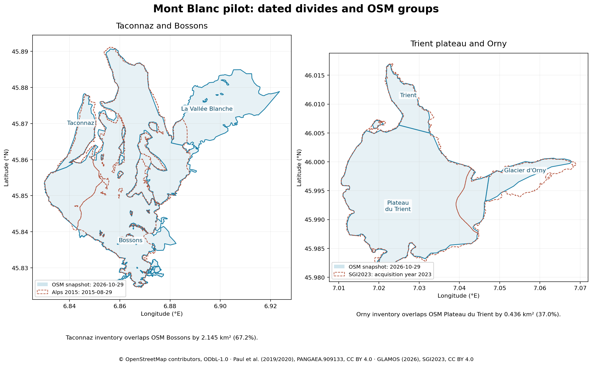

# Mont Blanc glacier pilot — 2026-10-29

**91 places: 86 named glaciers and five unnamed route exceptions.**
**Reviewed platform-stable manifest SHA-256:** `522908808212c1e2b814ecdf418b0ccd856d6785df91c1ddb54fbd711139091b`.

This draft uses merged #290 and #292. Changes stay in `cloud-sql/migrate/`,
this requested audit packet, and the requested glacier skill update. There
are no API, schema, filter, OSM or production changes. No infrastructure cost.

The query box is **45.72, 6.70, 46.08, 7.15** (south, west, north, east).
Whole polygons cross the box and country borders without splitting. The
roster groups separate OSM parts with the same glacier name into one place.
All part identities stay in catalog metadata and the cross-package check.

[Full decisions](mont-blanc-glacier-outline-decisions-2026-10-29.md),
[decision JSON](mont-blanc-glacier-outline-decisions-2026-10-29.json), and
[validation evidence](mont-blanc-validation-2026-10-29.json).
The builder is `cloud-sql/migrate/src/import-mont-blanc-glaciers.ts`.
The source directory is `cloud-sql/migrate/data/glaciers-mont-blanc-2026-10-29/`.

## Decisions applied

- All 15 connected inventory groups pass the 0.67–1.5 band. Their 37 member
  places keep OSM. Group totals belong only in the decision table. Tour has
  an independent named RGI row from a different split; the other 36 members
  have null facts and `facts: combined rows`.
- Ten individual places take dated inventory outlines under rule 2. The
  other 81 retain OSM. No outline is clipped or scaled.
- Trient and Orny form **2 rows ↔ 3 places**: B90-02 and B85-23 total
  **6.655772 km²**, versus **6.285327219 km²** of OSM (**0.944342327×**).
  All three keep OSM, all facts are null, and none has an outline-review flag.
- The Mer de Glace row covers eight places. The Miage system covers five
  places, including the route-qualified unnamed piece, and two linked rows.
  Argentière covers four places. All parents' “of N” counts count places.
- Individual facts exist for 53 places. The remaining 38 keep nulls, never
  zeros. No group figure becomes a branch fact. Source aspect is not ice flow.

## Taconnaz and the neighbour check

The 2015 Taconnaz outline overlaps OSM Bossons by **2.144655480 km²**, or
**67.1786467%** of the inventory outline. The named 2003 RGI Taconnaz row
contains **96.5493%** of that 2015 outline. The two dated inventories support
the same catchment identity; this is evidence of a different divide in OSM,
not evidence that the two inventory row labels were swapped. Record this
as a disagreement between the roster and inventory extents.

The rule builds the full connected neighbour group: French Bionnassay,
Taconnaz, Dôme, Italian Bionnassay, Gendarme Rouge, Vallée Blanche and Bossons.
Its all-inventory option lacks independent outlines for the combined-row
branches. Its score is therefore unavailable; OSM puts **2 of 7** individual
ratios in band. The general group fallback chooses **all OSM**. Taconnaz
keeps its area flag. There is no per-place `keep_osm` exception and no clip;
the discarded clipping path would remove about 67.6%, beyond the 10% cap.

The original OSM Gendarme Rouge outline overlaps Bossons by **0.071570239 km²**
(**98.9846247%** of the smaller outline). Both remain flagged. This overlap
already exists in OSM; source switching did not create it. It needs review
before a production apply. The all-repository cross-package check passes.



## Flags by kind

| Kind | Count | Places |
| --- | --- | --- |
| Ratio retained by neighbour rule | 1 | Taconnaz |
| Original OSM overlap | 2 | Bossons; Gendarme Rouge |
| No independent facts row | 2 | Glacier Oriental de l’Aiguille Blanche; Glacier de Combalet |
| Combined facts scope | 36 | See connected-group table; no outline flag unless separately listed above |

## Sources and terms

Every licence was checked and saved under `licence-evidence/`. Raw responses,
queries, response metadata and SHA-256 sums are saved. `SHA256SUMS` lists every
saved file. Public requests use `peaks-glacier-import/1.0`, no personal headers
and no authentication. Overpass requests were serial and limited to a short
query timeout; host failures remain cached rather than disguised as data.

| Source | Use | Licence | URL | Saved file SHA-256 |
| --- | --- | --- | --- | --- |
| OSM glaciers, base 2026-10-29T17:40:02Z | Outlines and local names | ODbL-1.0 | https://www.openstreetmap.org/copyright | 2d591ac91326122989ead78bab828375c1c695e07b8ece2b1fe9aa7dace0f979 |
| OSM countries, base 2026-10-29T17:41:05Z | Fixed FR/IT/CH admin_level=2 masks | ODbL-1.0 | https://overpass-api.de/api/interpreter | 402066c755cdbe84a4ede02da33936cb04216671ce42e60d19f7e7182ce4aa99 |
| OSM context, base 2026-10-29T17:53:16Z | Routes, huts, peaks and protected areas | ODbL-1.0 | https://overpass-api.de/api/interpreter | 32bb2e4921dcf55a3a820b77cfd56b382a79bbe07448394484d51c5fe0182e5d |
| Paul et al., Alps Sentinel-2 inventory, 2015-08-29 | Main facts cohort and outline candidates | CC BY 4.0 | https://doi.org/10.1594/PANGAEA.909133 | 7ab160fb022cc4fca45620d169dfe19d5fb17d4d1b9b0462650c948f87138991 |
| GLAMOS SGI2023 r2026, acquisition year 2023 | Newer Swiss facts and candidates | CC BY 4.0 | https://doi.glamos.ch/data/inventory/inventory_sgi2023_r2026.html | ecef353d4b70f760eda83c6131e5345a2fd999527ea560b0bda4b7c27823f9fb |
| RGI 7.0, central Europe | Branch search; Tour 2003 facts; Taconnaz name/divide check | CC BY 4.0 | https://doi.org/10.5067/F6JMOVY5NAVZ | a56bf038d68d030ab49ffe14087743edf549fb3c337d9f510044d8e6fbdc7171 |
| WGMS FoG 2026-02-10 | Branch and length search, no combined lengths copied | CC BY 4.0 | https://wgms.ch/data_policy/ | 60e925b5ad7e319df6742790f02fa14b6012bea49a75b4c6a04b8f50ac30d612 |

Wikidata labels, sitelinks and parent checks use CC0; the saved licensing page
is `licence-evidence/wikidata.html`. Public Peaks searches check names and
locations only. Their returned IDs do not enter the manifest or apply template.

Copernicus GLO-30 tiles and their four raw response hashes are in `copdem/`.
The licence allows commercial use and redistribution with its notice:
**© DLR e.V. 2010–2014 and © Airbus Defence and Space GmbH 2014–2018, provided
under COPERNICUS by the European Union and ESA; all rights reserved.** The full
notice and liability terms are saved in `copdem-glo30-license.pdf`. Heads are
highest valid surface-model pixel centres, not surveyed glacier-head facts.

The main cohort is the open 2015 Alps inventory. The newer SGI2023 supplies
Swiss data where it covers a whole place. SGI provides an acquisition year,
not a day: selected geometry has `observed_at: null`, `observed_year: 2023`,
`observation_precision: year`. Its elevations use swissALTI3D release 2025.
The Alps elevations use ALOS AW3D30. Tour's separate RGI facts date to 2003;
its elevation fields name COPDEM30 rather than claiming a 2003 DEM survey.

Nine original Alps rings have self-contacts. GDAL MakeValid splits those
contacts; it does not move the footprint. The saved ring-repair audit records
all nine IDs, hashes and area differences. GLAMOS and PANGAEA source rows
remain separate from the reviewed crosswalk; the builder checks that no
crosswalk record changed any source property or coordinate.

## Inclusion roster

Rule 1 = a cached alpine/ski path crosses or touches the outline. Rule 2 = a
named glacier has a Wikidata sitelink. Rule 3 = a named glacier on the massif
is at least 0.5 km². The full route IDs, tags, sitelinks and language aliases
are saved in `derived/place-inputs.json` and `derived/route-relevance.json`.
OSM local names remain display names. “Sea of Ice” is the English alias
supplied in the task. The five unnamed route exceptions use explicit generic
labels, not invented local names.

| Place | OSM parts | Why included | Facts km² (year) | Outline | Primary / countries |
| --- | --- | --- | --- | --- | --- |
| Glacier des Rognons | way:30764271 | 2: Q117757673 (commonswiki, frwiki); 1: paths way:311743621; 3: named flank, ≥0.5 km² | null | osm | FR / FR |
| Glacier des Grands Montets | way:30764329 | 2: Q113494604 (commonswiki, frwiki) | 0.102673 (2015) | osm | FR / FR |
| Glacier du Chardonnet | way:30764447 | 2: Q117765436 (commonswiki, frwiki); 1: paths way:314238235; 3: named flank, ≥0.5 km² | 0.729757 (2015) | osm | FR / FR |
| Glacier du Trident | way:30764477 | 2: Q117771656 (commonswiki, frwiki) | 0.0406933 (2015) | alps2015 | FR / FR |
| Glacier des Améthystes | way:30764480 | 2: Q117764236 (commonswiki, frwiki); 3: named flank, ≥0.5 km² | null | osm | FR / FR |
| Glacier des Rouges du Dolent | way:30764488 | 2: Q117763011 (commonswiki, frwiki) | null | osm | FR / FR |
| Glacier de Saleinaz | way:1393129239, way:30764493 | 2: Q674490 (cawiki, commonswiki); 1: paths way:311743623, way:314229929, way:314238235 (more in data); 3: named flank, ≥0.5 km² | 6.130559 (2023) | osm | CH / CH |
| Glacier d'Orny | way:30764508 | 2: Q597363 (cawiki, commonswiki) | null | osm | CH / CH |
| Glacier du Trient | way:30764602 | 2: Q670540 (cawiki, commonswiki); 1: paths way:314230479; 3: named flank, ≥0.5 km² | null | osm | CH / CH |
| Glacier de Bionnassay | way:31002693 | 1: paths way:72128599, way:72128660; 3: named flank, ≥0.5 km² | 3.75423 (2015) | osm | FR / FR,IT |
| Glacier de Taconnaz | way:31002694 | 2: Q3108351 (cawiki, cebwiki); 3: named flank, ≥0.5 km² | 3.19211 (2015) | osm ⚑ | FR / FR |
| Ghiacciaio di Pré de Bar | way:32668359 | 2: Q765115 (cawiki, commonswiki); 3: named flank, ≥0.5 km² | 2.71807 (2015) | osm | IT / IT |
| Ghiacciaio della Lex Blanche | way:32668385 | 2: Q3761702 (cawiki, commonswiki); 3: named flank, ≥0.5 km² | null | osm | IT / IT |
| Ghiacciaio del Freney | way:32668406 | 2: Q1104931 (commonswiki, eswiki); 1: paths way:382746707; 3: named flank, ≥0.5 km² | 0.95232 (2015) | osm | IT / IT |
| Ghiacciaio del Brouillard | way:32668421 | 2: Q3761680 (commonswiki, frwiki); 3: named flank, ≥0.5 km² | 1.10682 (2015) | osm | IT / IT |
| Ghiacciaio di Triolet | way:32673833 | 2: Q25636 (cawiki, commonswiki); 3: named flank, ≥0.5 km² | 3.26553 (2015) | osm | IT / IT |
| Glacier du Dolent | way:32673844 | 2: Q117795525 (commonswiki, frwiki); 3: named flank, ≥0.5 km² | 1.069295 (2023) | osm | CH / CH |
| Glacier de la Charpoua | way:32673847 | 2: Q18214370 (cawiki, commonswiki) | 0.316587 (2015) | osm | FR / FR |
| Ghiacciaio di Fréboudze | way:32673882 | 2: Q3108341 (cawiki, commonswiki); 3: named flank, ≥0.5 km² | 1.80876 (2015) | osm | IT / IT |
| Glacier du Dôme - Ghiacciaio del Dôme | way:32673896 | 2: Q2888732 (commonswiki, eswiki); 1: paths way:313298572; 3: named flank, ≥0.5 km² | null | osm | IT / IT |
| Glacier de Bionnassay - Ghiacciaio di Bionassay | way:32673906 | 2: Q5880622 (commonswiki, eswiki); 1: paths way:72128599; 3: named flank, ≥0.5 km² | null | osm | IT / IT |
| Glacier des Glaciers | way:32673957 | 2: Q3108363 (cawiki, cebwiki); 3: named flank, ≥0.5 km² | 1.18845 (2015) | osm | FR / FR |
| Ghiacciaio d'Estellette | way:32673960 | 2: Q117842041 (commonswiki, frwiki) | 0.29787 (2015) | osm | IT / IT |
| Glacier de Leschaux | way:32674163 | 2: Q1612543 (cawiki, cebwiki); 1: paths way:73028038, way:301981746; 3: named flank, ≥0.5 km² | null | osm | FR / FR |
| Glacier de Miage | way:32699610 | 2: Q3108344 (arwiki, commonswiki); 1: paths way:363137871; 3: named flank, ≥0.5 km² | 1.09671 (2015) | osm | FR / FR |
| Glacier des Pèlerins | way:32789117 | 2: Q3108367 (cawiki, commonswiki); 1: paths way:117544137, way:278378254, way:1365542198; 3: named flank, ≥0.5 km² | null | osm | FR / FR |
| Glacier de Blaitière | way:32789571 | 2: Q3108330 (cawiki, commonswiki); 3: named flank, ≥0.5 km² | null | osm | FR / FR |
| Glacier du Nant Blanc | way:32848659 | 2: Q2366090 (cawiki, commonswiki); 3: named flank, ≥0.5 km² | 0.571974 (2015) | osm | FR / FR |
| Glacier du Tacul | way:32950402 | 2: Q3108378 (cawiki, commonswiki); 1: paths way:720905238, way:720909751, way:1469449067 (more in data); 3: named flank, ≥0.5 km² | null | osm | FR / FR |
| Glacier de la Verte | way:45561171 | 2: Q117756788 (commonswiki, frwiki) | null | osm | FR / FR |
| Glacier de Tête Rousse | way:72128516 | 2: Q3108353 (cawiki, commonswiki); 1: paths way:72128537, way:130671107, way:301191617 | 0.0702127 (2015) | osm | FR / FR |
| Glacier de Trélaporte | way:108153677 | 2: Q117707505 (commonswiki, frwiki) | 0.137019 (2015) | osm | FR / FR |
| Glacier de la Thendia | way:108153678 | 2: Q117663896 (commonswiki, frwiki) | 0.045334 (2015) | osm | FR / FR |
| Glacier Rond | way:108153682 | 2: Q117663595 (commonswiki, frwiki) | 0.0926926 (2015) | osm | FR / FR |
| Glacier du Capucin | way:108156167 | 2: Q117708035 (frwiki) | 0.1108 (2015) | alps2015 | FR / FR |
| Glacier de Pierre Joseph | way:108156168 | 2: Q117709074 (commonswiki, frwiki) | 0.297076 (2015) | osm | FR / FR |
| Glacier de l'A Neuve | way:1117264656, way:135737649, way:267756169 | 2: Q59406 (cawiki, commonswiki); 1: paths way:135737223, way:311743622, way:311743623; 3: named flank, ≥0.5 km² | null | osm | CH / CH |
| Ghiacciaio du Chatelet | way:176390679 | 2: Q118315774 (commonswiki, frwiki) | 0.0400357 (2015) | alps2015 | IT / IT |
| Mer de Glace | way:188343637 | 2: Q583591 (bgwiki, cawiki); 1: paths way:73028038, way:720909751, way:973627109 (more in data); 3: named flank, ≥0.5 km² | null | osm | FR / FR |
| Glacier de la Griaz | way:193208266 | 2: Q117663252 (commonswiki, frwiki) | 0.199581 (2015) | osm | FR / FR |
| Glacier de Lognan | way:200660239 | 2: Q34835232 (cebwiki, commonswiki) | null | osm | FR / FR |
| Glacier de la Pendant | way:200660240 | 2: Q117756474 (commonswiki, frwiki) | null | osm | FR / FR |
| Glacier du Milieu | way:210128316 | 2: Q117765380 (commonswiki, frwiki) | 0.325945 (2015) | osm | FR / FR |
| Glacier du Tour Noir | way:210128317 | 2: Q117763563 (commonswiki, frwiki); 3: named flank, ≥0.5 km² | null | osm | FR / FR |
| Ghiacciaio Orientale del Petit Mont Blanc | way:234540325 | 2: Q118314079 (commonswiki, frwiki); 1: paths way:346366656, way:346366657, way:430023338 | 0.117493 (2015) | osm | IT / IT |
| Glacier d'Armancette | way:244065146 | 2: Q113486749 (commonswiki, frwiki); 1: paths way:72128642; 3: named flank, ≥0.5 km² | 0.590511 (2015) | osm | FR / FR |
| Glacier de Covagnet | way:244065147 | 2: Q113486775 (commonswiki, frwiki) | 0.309121 (2015) | osm | FR / FR |
| Glacier de la Bérangère | way:244065148, way:244065149, way:244065150 | 1: paths way:72128642, way:72128642, way:1190251083 | 0.0928643 (2015) | osm | FR / FR |
| Ghiacciaio del Gruetta | way:247923312 | 2: Q120974195 (frwiki) | 0.149951 (2015) | alps2015 | IT / IT |
| Glacier de Planpincieux | way:247923316 | 2: Q68526456 (cawiki, commonswiki); 1: paths way:615361746, way:615361748; 3: named flank, ≥0.5 km² | 1.00149 (2015) | osm | IT / IT |
| Glacier de Pra Sec | way:247923326 | 2: Q120974059 (commonswiki, frwiki) | 0.12439 (2015) | osm | IT / IT |
| Glacier de Tronchey | way:247923330 | 2: Q120974135 (commonswiki, frwiki) | 0.0714755 (2015) | osm | IT / IT |
| Glacier des Grandes Jorasses | way:247923334 | 2: Q118315797 (commonswiki, frwiki); 1: paths way:615361748; 3: named flank, ≥0.5 km² | 0.601198 (2015) | osm | IT / IT |
| Glacier du petit Mont Gruettaz | way:247923341 | 2: Q120974221 (frwiki) | 0.0115444 (2015) | alps2015 | IT / IT |
| Ghiacciaio occidental du Mont Gruettaz | way:247923343 | 2: Q120974170 (commonswiki, frwiki) | 0.243175 (2015) | osm | IT / IT |
| Glacier de Rochefort | way:247923349 | 3: named flank, ≥0.5 km² | 0.546609 (2015) | osm | IT / IT |
| Glacier de l'Aiguille de Tré-la-Tête Orientale | way:294947803 | 2: Q117836276 (commonswiki, frwiki) | 0.141237 (2015) | osm | IT / IT |
| Glacier du Col du Miage | way:301715191 | 2: Q113486946 (commonswiki, frwiki) | 0.0802617 (2015) | osm | IT / IT |
| Glacier du Moine | way:301985965 | 2: Q117711198 (commonswiki, frwiki) | 0.0142337 (2015) | alps2015 | FR / FR |
| Ghiacciaio di Toula | way:327069846 | 2: Q120973788 (commonswiki, frwiki); 3: named flank, ≥0.5 km² | 0.489696 (2015) | osm | IT / IT |
| Glacier du Col des Dômes | way:363120274 | 2: Q117661984 (frwiki) | 0.105014 (2015) | osm | FR / FR |
| Ghiacciaio di Entreves | way:394890290 | 2: Q120973614 (commonswiki, frwiki) | 0.0567149 (2015) | alps2015 | IT / IT |
| Glacier Oriental de l'Aiguille Blanche | way:777833954 | 2: Q120977007 (frwiki) | null | osm ⚑ | IT / IT |
| Glacier Septentrional des Aiguilles Blanches | way:777833955 | 2: Q120974248 (frwiki) | null | osm | IT / IT |
| Glacier du Gendarme Rouge | way:777833956 | 2: Q120977233 (frwiki) | null | osm ⚑ | IT / IT |
| Glacier de Combalet | way:777857679 | 2: Q120977438 (frwiki); 1: paths way:1422690658 | null | osm ⚑ | IT / IT |
| La Vallée Blanche | relation:106154 | 2: Q34838689 (cebwiki, commonswiki); 1: paths way:244441181, way:988113102, way:988113103 (more in data); 3: named flank, ≥0.5 km² | null | osm | FR / FR |
| Glacier du Géant | relation:106155 | 2: Q3108375 (cawiki, cebwiki); 3: named flank, ≥0.5 km² | null | osm | FR / FR |
| Glacier des Bossons | relation:106239 | 2: Q549647 (cawiki, cebwiki); 1: paths way:25798474, way:72128660, way:117544137 (more in data); 3: named flank, ≥0.5 km² | 11.6431 (2015) | osm ⚑ | FR / FR,IT |
| Glacier du Tour | relation:106731 | 2: Q2321467 (cawiki, cebwiki); 1: paths way:182514738, way:182514741, way:314229767 (more in data); 3: named flank, ≥0.5 km² | 8.12365700654927 (2003) | osm | FR / FR |
| Ghiacciaio del Monte Bianco | relation:108757 | 2: Q3761692 (commonswiki, eswiki); 3: named flank, ≥0.5 km² | null | osm | IT / IT |
| Ghiacciaio del Miage | relation:2589255 | 2: Q212613 (cawiki, cebwiki); 1: paths way:136707646, way:311452791, way:949104661 (more in data); 3: named flank, ≥0.5 km² | null | osm | IT / IT |
| Glacier d'Argentière | relation:2590255 | 2: Q200793 (cawiki, cebwiki); 1: paths way:311743621, way:314229767, way:314237488 (more in data); 3: named flank, ≥0.5 km² | null | osm | FR / FR |
| Glacier d'Envers du Plan | relation:2602489 | 2: Q117707726 (commonswiki, frwiki); 3: named flank, ≥0.5 km² | null | osm | FR / FR |
| Glacier des Grands | relation:3011613 | 2: Q117792760 (commonswiki, frwiki); 1: paths way:265394493; 3: named flank, ≥0.5 km² | 1.293279 (2023) | osm | CH / CH |
| Glacier du Bourgeat | relation:3280098 | 2: Q117663318 (commonswiki, frwiki); 1: paths way:242710872 | 0.0438189 (2015) | alps2015 | FR / FR |
| Glacier de Tré-la-Tête | relation:3299816 | 2: Q1656465 (cawiki, cebwiki); 1: paths way:72128642, way:72128652, way:371773580 (more in data); 3: named flank, ≥0.5 km² | null | osm | FR / FR |
| Ghiacciaio del Petit Mont Blanc | relation:5395034 | 2: Q117836462 (commonswiki, frwiki); 1: paths way:346366657; 3: named flank, ≥0.5 km² | null | osm | IT / FR,IT |
| Ghiacciaio della Brenva | relation:5397135 | 2: Q1065529 (cawiki, commonswiki); 3: named flank, ≥0.5 km² | null | osm | IT / IT |
| Glacier des Berons | relation:14797906 | 2: Q117790879 (frwiki); 1: paths way:152197881 | 0.109979 (2023) | osm | CH / CH |
| Glacier d'Envers de Blaitière | relation:14911730 | 2: Q117707611 (commonswiki, frwiki); 3: named flank, ≥0.5 km² | null | osm | FR / FR |
| Glacier des Nantillons | relation:14935779 | 2: Q2419346 (cawiki, commonswiki) | 0.378652 (2015) | alps2015 | FR / FR |
| Glacier des Périades | relation:14935795 | 2: Q24934140 (cawiki, commonswiki); 1: paths way:1469449067, way:1469449069; 3: named flank, ≥0.5 km² | null | osm | FR / FR |
| Plateau du Trient | relation:14973797 | 1: paths way:182514740, way:182514741, way:265394493 (more in data); 3: named flank, ≥0.5 km² | null | osm | CH / CH |
| Glacier du Mont Mallet | relation:16854812 | 2: Q34835874 (cebwiki, commonswiki); 3: named flank, ≥0.5 km² | null | osm | FR / FR |
| Glacier de Talèfre | relation:19218925 | 2: Q3108352 (cawiki, cebwiki); 1: paths way:73028038; 3: named flank, ≥0.5 km² | 6.64753 (2015) | osm | FR / FR |
| Unnamed glacier (way 363120277) | way:363120277 | 1: paths way:72128652 | 0.487677 (2015) | osm | FR / FR |
| Unnamed glacier (way 1394999701) | way:1394999701 | 1: paths way:314606275 | null | osm | CH / CH |
| Unnamed glacier (way 1394999702) | way:1394999702 | 1: paths way:314606275 | null | osm | CH / CH |
| Unnamed glacier (way 1394999703) | way:1394999703 | 1: paths way:314606275 | 0.339479 (2023) | sgi2023 | CH / CH |
| Unnamed glacier (relation 1649757) | relation:1649757 | 1: paths way:1161481191 | null | osm | IT / IT |

## Named places excluded

| Name | OSM parts | OSM km² | Reason |
| --- | --- | --- | --- |
| Glacier de la Floria | way:39218506 | 0.1299 | Outside Mont Blanc massif: Aiguilles Rouges/Buet/Finive or Rutor/Chavannes side |
| Glacier de Bérard | way:39218509 | 0.0872 | Outside Mont Blanc massif: Aiguilles Rouges/Buet/Finive or Rutor/Chavannes side |
| Glacier d'Anneuley | way:39218510 | 0.0846 | Outside Mont Blanc massif: Aiguilles Rouges/Buet/Finive or Rutor/Chavannes side |
| Glacier de Beugeant | way:39218511, way:39218512 | 0.1128 | Outside Mont Blanc massif: Aiguilles Rouges/Buet/Finive or Rutor/Chavannes side |
| Glacier des Lanchettes | way:42263290 | 0.2505 | No sitelink, no cached alpine/ski route intersection, and below the 0.5 km² size criterion. |
| Haute Glacier du Freney | way:193208253 | 0.1673 | No sitelink, no cached alpine/ski route intersection, and below the 0.5 km² size criterion. |
| Glacier de Tré les Eaux | way:236042193 | 0.1130 | Outside Mont Blanc massif: Aiguilles Rouges/Buet/Finive or Rutor/Chavannes side |
| Glacier d'Enclave | way:237093491 | 0.0528 | No sitelink, no cached alpine/ski route intersection, and below the 0.5 km² size criterion. |
| Glacier du Mont Tondu | way:237093494 | 0.3767 | No sitelink, no cached alpine/ski route intersection, and below the 0.5 km² size criterion. |
| Ghiacciaio del Breuil | way:244229460 | 0.0121 | Outside Mont Blanc massif: Aiguilles Rouges/Buet/Finive or Rutor/Chavannes side |
| Ghiacciaio di Chavannes | way:244229462 | 0.1084 | Outside Mont Blanc massif: Aiguilles Rouges/Buet/Finive or Rutor/Chavannes side |
| Glacier de la Finive | way:251507369, way:251507370 | 0.0731 | Outside Mont Blanc massif: Aiguilles Rouges/Buet/Finive or Rutor/Chavannes side |
| Glacier de la Plate | way:740052752 | 0.0343 | No sitelink, no cached alpine/ski route intersection, and below the 0.5 km² size criterion. |
| Glacier Blanc | way:32818852 | 0.0259 | Aiguilles Rouges, outside this massif |

Twenty-five other unnamed source polygons have no qualifying cached path and
stay out. The five nearby named exclusions within this massif have neither a
sitelink nor a cached qualifying path, and lie below the size cut. The nearest
cached huts to Lanchettes, Haute Freney, Enclave, Mont Tondu and Plate are
about 675 m, 2333 m, 1561 m, 902 m and 3445 m away. A missing path tag is not
proof that nobody visits; these exclusions remain visible for roster review.

## Connected inventory groups

Each row below lists the original rows with their own area and date, not an
invented merged inventory ID. The JSON gives all members, residual pieces,
nonmember overlaps and source hashes. The union check includes every OSM
snapshot polygon, including unnamed ice. It rejects double-counted members.
Residual inventory margins remain recorded; passing the band does not make
those contours identical or turn a snapshot date into an ice-observation date.

| Rows: ID / km² / date | Member places | OSM total km² | Ratio | Inventory covered | Choice |
| --- | --- | --- | --- | --- | --- |
| alps2015:2873 / 7.25041 / 2015-08-29; alps2015:585 / 0.0244704 / 2015-08-29; alps2015:588 / 0.0349013 / 2015-08-29; alps2015:594 / 0.0590064 / 2015-08-29 | Glacier de Tré-la-Tête | 6.868506852 | 0.932108070 | 86.86% | osm; facts: combined rows |
| alps2015:2872 / 0.255665 / 2015-08-29; alps2015:589 / 2.95389 / 2015-08-29 | Ghiacciaio del Petit Mont Blanc; Ghiacciaio della Lex Blanche | 3.369024421 | 1.049685835 | 97.28% | osm; facts: combined rows |
| alps2015:602 / 0.164082 / 2015-08-29; alps2015:697 / 10.0851 / 2015-08-29 | Ghiacciaio del Monte Bianco; Unnamed glacier (relation 1649757); Ghiacciaio del Miage; Glacier du Dôme - Ghiacciaio del Dôme; Glacier de Bionnassay - Ghiacciaio di Bionassay | 9.804386294 | 0.956601834 | 88.96% | osm; facts: combined rows |
| alps2015:2879 / 0.291376 / 2015-08-29; alps2015:625 / 0.100903 / 2015-08-29; alps2015:639 / 0.675324 / 2015-08-29 | Glacier des Pèlerins | 1.369820297 | 1.283080225 | 91.67% | osm; facts: combined rows |
| alps2015:636 / 0.0411251 / 2015-08-29; alps2015:640 / 0.0206182 / 2015-08-29; alps2015:650 / 0.36793 / 2015-08-29 | Glacier de Blaitière | 0.547628377 | 1.274522706 | 95.35% | osm; facts: combined rows |
| alps2015:641 / 0.526525 / 2015-08-29; alps2015:645 / 0.0380744 / 2015-08-29 | Glacier d'Envers de Blaitière | 0.601638545 | 1.065602523 | 96.03% | osm; facts: combined rows |
| alps2015:717 / 1.01733 / 2015-08-29 | Glacier du Tour Noir; Glacier des Rouges du Dolent | 0.873345382 | 0.858468129 | 74.74% | osm; facts: combined rows |
| alps2015:831 / 0.304567 / 2015-08-29; alps2015:857 / 6.59243 / 2015-08-29 | Glacier du Tour | 6.282559446 | 0.910912307 | 88.79% | osm; facts: combined rows |
| alps2015:2880 / 0.399111 / 2015-08-29 | Glacier de Lognan; Glacier de la Pendant | 0.354847621 | 0.889095066 | 80.78% | osm; facts: combined rows |
| alps2015:3143 / 28.8028 / 2015-08-29 | La Vallée Blanche; Glacier du Géant; Glacier des Périades; Glacier du Mont Mallet; Glacier d'Envers du Plan; Mer de Glace; Glacier de Leschaux; Glacier du Tacul | 27.656371519 | 0.960197325 | 91.67% | osm; facts: combined rows |
| alps2015:3165 / 5.95191 / 2015-08-29 | Ghiacciaio della Brenva; Glacier Septentrional des Aiguilles Blanches; Glacier du Gendarme Rouge | 5.408486652 | 0.908697654 | 78.70% | osm; facts: combined rows |
| alps2015:3192 / 11.2352 / 2015-08-29 | Glacier d'Argentière; Glacier des Rognons; Glacier des Améthystes; Glacier de la Verte | 10.354553349 | 0.921617181 | 88.52% | osm; facts: combined rows |
| sgi2023:B85-07 / 1.649641 / 2023; sgi2023:B85-08 / 0.781074 / 2023; sgi2023:B85-26 / 0.278569 / 2023 | Glacier de l'A Neuve | 2.273697382 | 0.839224453 | 80.00% | osm; facts: combined rows |
| sgi2023:B85-23 / 1.178249 / 2023; sgi2023:B90-02 / 5.477523 / 2023 | Plateau du Trient; Glacier d'Orny; Glacier du Trient | 6.285327219 | 0.944342327 | 93.69% | osm; facts: combined rows |
| sgi2023:B85-13 / 0.489129 / 2023 | Unnamed glacier (way 1394999701); Unnamed glacier (way 1394999702) | 0.346490517 | 0.708382690 | 70.69% | osm; facts: combined rows |

`derived/rgi-branch-search.json` records every >10% spatial branch candidate.
RGI still combines Mer de Glace/Géant, Miage and Trient; its differently named
Leschaux row is a separate small glacier. Pèlerins, Blaitière, Tré-la-Tête and
A Neuve still intersect several RGI rows. Tour alone has a named one-to-one
alternative (RGI2000-v7.0-G-11-00738), so it receives 8.12365700654927 km²,
2003-08-13, and that row's other facts. Unnamed RGI matches do not establish a
named branch crosswalk. WGMS records 353 (Mer), 613 (Miage) and 457 (Trient)
give whole-system figures. WGMS 1226 “Leschaux” is the separate 0.11 km² glacier
at 45.8801, 7.0108, not this Leschaux branch. No figure is apportioned by area.

## Parents and containers

Parents are the nearest named OSM peak to the highest Copernicus GLO-30 pixel
centre in the selected whole outline. `scripts/glacier-dem-heads.py` reproduces
all 91 heads and the nearest three candidates from the saved sources. The
parent match radius is **300 m**. All IDs remain open inputs for the privileged
apply, including parents whose public search matched.

Public Peaks search verifies 39 of 69 distinct candidates. The other 30 are
marked **parent missing**, not replaced by a more distant summit or a guessed
ID. A missing search match does not prove that every spelling is absent.
Wikidata is a cross-check: 52 candidates have tagged items. Its locations for
Aiguille de Blaitière and Petite Aiguille Verte differ from OSM by about 1096 m
and 583 m; this package retains the OSM locations, which the public Peaks
search matches. `derived/parent-wikidata-check.json` records the offsets.

All places have **no container**. The cached OSM context includes seven
protected-area relations. Contamines-Montjoie and the Trient regional park
are the relevant candidates; public Peaks searches for “Contamines” and
“Trient” returned no area matches. The others cover the excluded Aiguilles
Rouges/Passy side. No WDPA data or guessed area ID is used.

| Open parent key | Identity name | lat, lng | Country | Radius m | of N | Public check |
| --- | --- | --- | --- | --- | --- | --- |
| node-10870208659 | Pointes des Grands | 46.0029179, 6.990594 | CH | 300 | 1 | parent missing |
| node-11536828038 | Pointe Morin | 45.9435268, 7.0365985 | FR | 300 | 1 | matched |
| node-11537086260 | Crête Sèche | 45.9596501, 7.0769228 | CH | 300 | 1 | matched |
| node-11537833258 | Pointe des Ravines Rousses | 45.9921684, 7.0476215 | CH | 300 | 1 | parent missing |
| node-11538075850 | Petit Darrey | 45.960101, 7.0568017 | CH | 300 | 2 | parent missing |
| node-1241260305 | Aiguille de la République | 45.9056685, 6.9212635 | FR | 300 | 1 | parent missing |
| node-1241260441 | La Tour Rouge | 45.9032079, 6.9249313 | FR | 300 | 1 | parent missing |
| node-12892609514 | Mont Dolent / Monte Dolent | 45.9219579, 7.046165 | CH | 300 | 3 | matched |
| node-13013728246 | Petit Rognon | 45.8797529, 6.9193466 | FR | 300 | 1 | matched |
| node-13013811813 | Tête de Trélaporte | 45.9081159, 6.9308257 | FR | 300 | 1 | matched |
| node-13467926092 | Pic de la Brenva | 45.8392346, 6.9144103 | IT | 300 | 1 | parent missing |
| node-13467931023 | Punta Welzenbach | 45.8111394, 6.8932571 | IT | 300 | 1 | parent missing |
| node-1438494348 | Aiguille du Goûter | 45.8509504, 6.8312381 | FR | 300 | 4 | matched |
| node-167075493 | Aiguille du Midi | 45.878813, 6.887382 | FR | 300 | 2 | matched |
| node-2151026961 | L'Isolée | 45.8545834, 6.8909713 | FR | 300 | 1 | parent missing |
| node-2401280720 | Aiguille des Grands Montets | 45.9482017, 6.9605461 | FR | 300 | 2 | matched |
| node-2409782067 | Pic Eccles | 45.8216427, 6.8748036 | IT | 300 | 2 | matched |
| node-2417756510 | Triangle du Tacul | 45.8608217, 6.888008 | FR | 300 | 1 | parent missing |
| node-2427826282 | Aiguille de Tré-la-Tête Orientale | 45.7943135, 6.8181647 | IT | 300 | 1 | parent missing |
| node-26862462 | Aiguille Verte | 45.9345904, 6.9700185 | FR | 300 | 1 | matched |
| node-26862463 | Aiguille de Tré-la-Tête Centrale Sud-Est | 45.7946096, 6.8150821 | IT | 300 | 1 | matched |
| node-26863024 | Grandes Jorasses / Pointe Walker | 45.8681562, 6.9889831 | FR | 300 | 1 | matched |
| node-281399025 | Mont Blanc | 45.832704, 6.864797 | FR | 300 | 2 | matched |
| node-290497885 | Aiguille du Tour | 45.9945308, 7.0100128 | FR | 300 | 1 | matched |
| node-290497892 | Aiguille de Chardonnet | 45.968306, 7.0015516 | FR | 300 | 2 | matched |
| node-290497894 | Aiguille d'Argentière | 45.959721, 7.020211 | FR | 300 | 2 | matched |
| node-290497905 | Grand Darray | 45.9589745, 7.0605282 | CH | 300 | 1 | matched |
| node-307195492 | Pointe Hélène / Punta Elena | 45.8687569, 6.9793403 | FR | 300 | 1 | matched |
| node-307195544 | Aiguille de Leschaux | 45.8872044, 7.0066752 | IT | 300 | 1 | matched |
| node-307195579 | Aiguille de Talèfre | 45.899499, 7.0037821 | FR | 300 | 1 | matched |
| node-307676211 | Aiguille des Glaciers | 45.7783901, 6.802571 | FR | 300 | 1 | matched |
| node-340235998 | Aiguille de Rochefort | 45.8621023, 6.9599716 | FR | 300 | 1 | matched |
| node-344715578 | Aiguille du Plan | 45.8916, 6.907189 | FR | 300 | 3 | matched |
| node-344715579 | Aiguille de Blaitière | 45.8989201, 6.9133265 | FR | 300 | 1 | matched |
| node-344715662 | Aiguille du Tacul | 45.88475, 6.961065 | FR | 300 | 1 | matched |
| node-3559071817 | Dome de Goûter | 45.842726, 6.843735 | FR | 300 | 2 | matched |
| node-3613468597 | Aiguille de Tré-la-Tête Centrale Nord-Ouest | 45.7955742, 6.8133076 | FR | 300 | 1 | parent missing |
| node-366260714 | Aiguille de Bionnassay | 45.836054, 6.8186739 | FR | 300 | 1 | matched |
| node-3668636373 | Petite Aiguille des Glaciers | 45.7712476, 6.804148 | FR | 300 | 1 | parent missing |
| node-3668810726 | Aiguille de Tré-la-Tête Nord | 45.7982424, 6.8114176 | IT | 300 | 1 | parent missing |
| node-367510882 | Petit Mont Blanc | 45.7917719, 6.8329652 | IT | 300 | 1 | parent missing |
| node-367945270 | Monte Gruetta | 45.8842279, 7.0209502 | IT | 300 | 3 | matched |
| node-367945278 | Aiguille du Moine | 45.9166313, 6.9614334 | FR | 300 | 1 | matched |
| node-367945311 | Aiguille Blanche de Peuterey - Nord | 45.8237506, 6.8812639 | IT | 300 | 1 | parent missing |
| node-367945330 | Dômes de Miage | 45.8152681, 6.8002767 | FR | 300 | 1 | matched |
| node-367945338 | Aiguille de la Bérangère | 45.8027724, 6.7787895 | FR | 300 | 1 | parent missing |
| node-369467782 | Le Cardinal | 45.9281947, 6.9655031 | FR | 300 | 1 | parent missing |
| node-3848979146 | Rocher de la Tournette | 45.8328834, 6.8599134 | FR | 300 | 2 | parent missing |
| node-3977814005 | Aiguille de Tronchey | 45.8642725, 6.9986809 | IT | 300 | 2 | parent missing |
| node-4095457700 | Petite Pointe d'Orny | 46.006166, 7.0372142 | CH | 300 | 1 | matched |
| node-4357285689 | Petite Aiguille Verte | 45.9438549, 6.963623 | FR | 300 | 2 | matched |
| node-503688535 | Pointe de Pré de Bar Est | 45.9212942, 7.03817 | FR | 300 | 1 | parent missing |
| node-5818422347 | Pointe Sella | 45.8616766, 6.9518096 | FR | 300 | 1 | parent missing |
| node-7164832069 | Aiguille d'Entrèves | 45.8448332, 6.9170955 | FR | 300 | 1 | matched |
| node-7164832145 | Dent du Géant | 45.861881, 6.952117 | FR | 300 | 1 | matched |
| node-7251779831 | Pyramides des Aiguilles Grises | 45.8217004, 6.8291992 | IT | 300 | 1 | parent missing |
| node-7256451496 | Aiguille Blanche de Peuterey - Sud | 45.8230537, 6.8840772 | IT | 300 | 1 | matched |
| node-7274424291 | Pointe des Hirondelles Sud | 45.8738943, 6.999101 | FR | 300 | 1 | parent missing |
| node-7274427714 | Pointe Isabelle Sud / Punta Isabella Sud | 45.9138529, 7.0182842 | IT | 300 | 1 | parent missing |
| node-7274586194 | Petite Aiguille de Triolet Orientale | 45.9166576, 7.0226777 | IT | 300 | 1 | parent missing |
| node-7973584578 | Pointe Croux | 45.9344081, 6.9653857 | FR | 300 | 1 | parent missing |
| node-808543830 | Aiguille Croux | 45.8107123, 6.8850697 | IT | 300 | 1 | parent missing |
| node-808543911 | Grand Pilier d'Angle | 45.828026, 6.879269 | IT | 300 | 1 | matched |
| node-8394948806 | Aiguilles du Pissoir | 45.9972907, 7.0103174 | FR | 300 | 1 | parent missing |
| node-8398131979 | Tour Noir | 45.94884, 7.0374269 | FR | 300 | 2 | matched |
| node-857445639 | Dômes de Miage (5ème dôme) | 45.8158975, 6.8032859 | FR | 300 | 1 | matched |
| node-857445641 | Dômes de Miage (2nd dôme) | 45.813531, 6.7939263 | FR | 300 | 1 | parent missing |
| node-857445645 | Dômes de Miage - Pointe Sud-Ouest | 45.8104261, 6.7897905 | FR | 300 | 2 | parent missing |
| node-857445692 | Piton des Italiens | 45.8372078, 6.8304317 | FR | 300 | 1 | matched |

| Glacier | Parent key | DEM head m | Head lat, lng | Nearest summit distance m |
| --- | --- | --- | --- | --- |
| Glacier des Rognons | node-4357285689 | 3253.89 | 45.94611111, 6.96333333 | 251.9 |
| Glacier des Grands Montets | node-4357285689 | 3392.87 | 45.94416667, 6.9625 | 93.5 |
| Glacier du Chardonnet | node-290497894 | 3676.92 | 45.96027778, 7.015 | 407.5 |
| Glacier du Trident | node-290497892 | 3187.09 | 45.96444444, 6.9975 | 531.5 |
| Glacier des Améthystes | node-8398131979 | 3569.61 | 45.94944444, 7.03472222 | 219.6 |
| Glacier des Rouges du Dolent | node-11536828038 | 3390.93 | 45.94166667, 7.03555556 | 222.0 |
| Glacier de Saleinaz | node-11538075850 | 3341.13 | 45.95861111, 7.05472222 | 230.8 |
| Glacier d'Orny | node-11537833258 | 3074.98 | 45.99333333, 7.04666667 | 149.1 |
| Glacier du Trient | node-4095457700 | 2902.66 | 46.00527778, 7.0325 | 377.3 |
| Glacier de Bionnassay | node-3559071817 | 4287.42 | 45.84111111, 6.84166667 | 215.1 |
| Glacier de Taconnaz | node-1438494348 | 3501.01 | 45.85694444, 6.83472222 | 719.1 |
| Ghiacciaio di Pré de Bar | node-12892609514 | 3630.88 | 45.92, 7.0475 | 241.0 |
| Ghiacciaio della Lex Blanche | node-3613468597 | 3654.13 | 45.795, 6.80944444 | 306.2 |
| Ghiacciaio del Freney | node-2409782067 | 3662.61 | 45.82222222, 6.8775 | 218.7 |
| Ghiacciaio del Brouillard | node-2409782067 | 3981.23 | 45.82194444, 6.8725 | 181.6 |
| Ghiacciaio di Triolet | node-7274427714 | 3471.51 | 45.91361111, 7.02111111 | 220.3 |
| Glacier du Dolent | node-12892609514 | 3529.20 | 45.92222222, 7.04888889 | 212.7 |
| Glacier de la Charpoua | node-369467782 | 3331.60 | 45.92972222, 6.96416667 | 198.8 |
| Ghiacciaio di Fréboudze | node-7274424291 | 3492.45 | 45.87111111, 6.995 | 443.4 |
| Glacier du Dôme - Ghiacciaio del Dôme | node-3559071817 | 4232.84 | 45.84055556, 6.84222222 | 245.1 |
| Glacier de Bionnassay - Ghiacciaio di Bionassay | node-857445692 | 3927.44 | 45.83666667, 6.82972222 | 81.5 |
| Glacier des Glaciers | node-307676211 | 3669.72 | 45.78, 6.80138889 | 201.1 |
| Ghiacciaio d'Estellette | node-3668636373 | 3225.35 | 45.77472222, 6.80666667 | 432.9 |
| Glacier de Leschaux | node-307195544 | 3419.78 | 45.88527778, 7.00444444 | 275.2 |
| Glacier de Miage | node-366260714 | 3598.51 | 45.83083333, 6.81555556 | 628.8 |
| Glacier des Pèlerins | node-167075493 | 3695.10 | 45.87944444, 6.88888889 | 148.7 |
| Glacier de Blaitière | node-344715578 | 3593.90 | 45.89222222, 6.90722222 | 58.0 |
| Glacier du Nant Blanc | node-7973584578 | 3694.27 | 45.93583333, 6.96444444 | 174.4 |
| Glacier du Tacul | node-13013728246 | 2641.17 | 45.87694444, 6.92888889 | 802.0 |
| Glacier de la Verte | node-26862462 | 4092.10 | 45.93472222, 6.96944444 | 46.8 |
| Glacier de Tête Rousse | node-1438494348 | 3319.70 | 45.85611111, 6.82361111 | 823.5 |
| Glacier de Trélaporte | node-1241260441 | 2759.68 | 45.90555556, 6.92472222 | 261.5 |
| Glacier de la Thendia | node-1241260305 | 2686.75 | 45.90944444, 6.92055556 | 423.4 |
| Glacier Rond | node-167075493 | 2920.01 | 45.88027778, 6.87916667 | 659.1 |
| Glacier du Capucin | node-344715662 | 3046.55 | 45.88527778, 6.96555556 | 383.9 |
| Glacier de Pierre Joseph | node-307195579 | 3348.08 | 45.89777778, 7.00027778 | 331.9 |
| Glacier de l'A Neuve | node-12892609514 | 3683.16 | 45.92305556, 7.04472222 | 165.4 |
| Ghiacciaio du Chatelet | node-808543830 | 3061.80 | 45.81055556, 6.88277778 | 178.5 |
| Mer de Glace | node-13013811813 | 2113.95 | 45.90277778, 6.93583333 | 708.9 |
| Glacier de la Griaz | node-1438494348 | 3229.93 | 45.85805556, 6.82666667 | 865.7 |
| Glacier de Lognan | node-2401280720 | 3166.78 | 45.94833333, 6.95861111 | 150.3 |
| Glacier de la Pendant | node-2401280720 | 3197.91 | 45.94777778, 6.95888889 | 136.5 |
| Glacier du Milieu | node-290497894 | 3716.73 | 45.95833333, 7.01777778 | 243.3 |
| Glacier du Tour Noir | node-8398131979 | 3680.76 | 45.94805556, 7.03666667 | 105.2 |
| Ghiacciaio Orientale del Petit Mont Blanc | node-367510882 | 3388.42 | 45.79138889, 6.83305556 | 43.2 |
| Glacier d'Armancette | node-857445645 | 3647.88 | 45.81055556, 6.79 | 21.7 |
| Glacier de Covagnet | node-857445645 | 3316.27 | 45.81361111, 6.78888889 | 361.0 |
| Glacier de la Bérangère | node-367945338 | 3365.14 | 45.80222222, 6.77833333 | 70.7 |
| Ghiacciaio del Gruetta | node-367945270 | 3223.30 | 45.88416667, 7.02444444 | 270.6 |
| Glacier de Planpincieux | node-307195492 | 3641.00 | 45.86583333, 6.97944444 | 325.2 |
| Glacier de Pra Sec | node-3977814005 | 3198.74 | 45.86305556, 6.99361111 | 415.2 |
| Glacier de Tronchey | node-3977814005 | 3367.26 | 45.86472222, 6.99611111 | 205.2 |
| Glacier des Grandes Jorasses | node-26863024 | 4158.99 | 45.86833333, 6.98861111 | 34.9 |
| Glacier du petit Mont Gruettaz | node-367945270 | 2785.12 | 45.87638889, 7.02805556 | 1030.7 |
| Ghiacciaio occidental du Mont Gruettaz | node-367945270 | 3593.19 | 45.885, 7.01388889 | 553.3 |
| Glacier de Rochefort | node-5818422347 | 3240.46 | 45.855, 6.95166667 | 742.5 |
| Glacier de l'Aiguille de Tré-la-Tête Orientale | node-2427826282 | 3710.85 | 45.79416667, 6.82083333 | 207.5 |
| Glacier du Col du Miage | node-7251779831 | 3358.43 | 45.825, 6.81444444 | 1200.7 |
| Glacier du Moine | node-367945278 | 2901.63 | 45.91305556, 6.96194444 | 399.6 |
| Ghiacciaio di Toula | node-7164832069 | 3366.64 | 45.84444444, 6.91944444 | 187.0 |
| Glacier du Col des Dômes | node-857445641 | 3319.76 | 45.81638889, 6.79444444 | 320.3 |
| Ghiacciaio di Entreves | node-13467926092 | 3307.12 | 45.84027778, 6.91666667 | 209.8 |
| Glacier Oriental de l'Aiguille Blanche | node-7256451496 | 3316.06 | 45.825, 6.89138889 | 606.5 |
| Glacier Septentrional des Aiguilles Blanches | node-367945311 | 3935.19 | 45.82472222, 6.88111111 | 108.7 |
| Glacier du Gendarme Rouge | node-281399025 | 4245.98 | 45.83666667, 6.87388889 | 806.3 |
| Glacier de Combalet | node-13467931023 | 2782.12 | 45.81111111, 6.89638889 | 242.8 |
| La Vallée Blanche | node-2417756510 | 3710.08 | 45.86416667, 6.88888889 | 378.1 |
| Glacier du Géant | node-2151026961 | 3747.31 | 45.85027778, 6.88583333 | 622.6 |
| Glacier des Bossons | node-281399025 | 4810.72 | 45.83277778, 6.86472222 | 35.7 |
| Glacier du Tour | node-290497892 | 3635.32 | 45.96944444, 7.00583333 | 354.3 |
| Ghiacciaio del Monte Bianco | node-3848979146 | 4014.56 | 45.82777778, 6.85694444 | 612.6 |
| Ghiacciaio del Miage | node-857445639 | 3318.15 | 45.81305556, 6.80861111 | 519.8 |
| Glacier d'Argentière | node-503688535 | 3308.76 | 45.92416667, 7.04027778 | 358.6 |
| Glacier d'Envers du Plan | node-344715578 | 3583.74 | 45.89138889, 6.90694444 | 41.1 |
| Glacier des Grands | node-8394948806 | 3270.89 | 45.99944444, 7.01138889 | 253.4 |
| Glacier du Bourgeat | node-1438494348 | 3217.68 | 45.85888889, 6.83027778 | 885.8 |
| Glacier de Tré-la-Tête | node-3668810726 | 3858.46 | 45.79833333, 6.81138889 | 10.4 |
| Ghiacciaio del Petit Mont Blanc | node-26862463 | 3892.37 | 45.795, 6.81472222 | 51.6 |
| Ghiacciaio della Brenva | node-808543911 | 3806.61 | 45.83111111, 6.88 | 362.8 |
| Glacier des Berons | node-10870208659 | 3075.00 | 46.00361111, 6.98972222 | 102.3 |
| Glacier d'Envers de Blaitière | node-344715578 | 3298.44 | 45.89111111, 6.91 | 224.3 |
| Glacier des Nantillons | node-344715579 | 3319.38 | 45.9, 6.91527778 | 190.4 |
| Glacier des Périades | node-7164832145 | 3729.96 | 45.8625, 6.95 | 161.6 |
| Plateau du Trient | node-290497885 | 3450.74 | 45.99416667, 7.01111111 | 94.0 |
| Glacier du Mont Mallet | node-340235998 | 3941.74 | 45.86222222, 6.95972222 | 23.5 |
| Glacier de Talèfre | node-7274586194 | 3752.77 | 45.91694444, 7.02305556 | 43.3 |
| Unnamed glacier (way 363120277) | node-367945330 | 3630.30 | 45.81555556, 6.80083333 | 53.7 |
| Unnamed glacier (way 1394999701) | node-11538075850 | 3387.95 | 45.95972222, 7.05861111 | 146.1 |
| Unnamed glacier (way 1394999702) | node-11537086260 | 2957.82 | 45.96, 7.06972222 | 558.0 |
| Unnamed glacier (way 1394999703) | node-290497905 | 3277.83 | 45.96, 7.06222222 | 173.6 |
| Unnamed glacier (relation 1649757) | node-3848979146 | 4643.35 | 45.83305556, 6.85916667 | 60.9 |

## Country assignment and filter gaps

Each place uses the greatest measured overlap with fixed, hashed OSM admin2
FR/IT/CH boundaries. Rounded ties use alphabetical ISO codes. Secondary
countries need at least max(0.01 km², 1% of the outline). The sorted list and
all overlap decisions enter the manifest hash. The masks overlap on the
Mont Blanc claim boundary; overlap totals can exceed the glacier area. This
reports the OSM snapshot, not a ruling on the international boundary.

These secondary-country queries will miss the listed places until filters
match `country_codes`:

| Glacier | Current primary | Secondary filter misses |
| --- | --- | --- |
| Glacier de Bionnassay | FR | IT |
| Glacier des Bossons | FR | IT |
| Ghiacciaio del Petit Mont Blanc | IT | FR |

Dropped border slivers:

| Glacier | Dropped country | Overlap km² | Cutoff km² |
| --- | --- | --- | --- |
| Ghiacciaio di Pré de Bar | CH | 0.002211513 | 0.024561846 |
| Ghiacciaio della Lex Blanche | FR | 0.024171400 | 0.024818235 |
| Ghiacciaio di Fréboudze | FR | 0.001683371 | 0.014555077 |
| Glacier de Bionnassay - Ghiacciaio di Bionassay | FR | 0.000150345 | 0.010127468 |
| Glacier des Glaciers | IT | 0.001454709 | 0.012253801 |
| Glacier des Grandes Jorasses | FR | 0.004571300 | 0.010000000 |
| Glacier du Col du Miage | FR | 0.001440927 | 0.010000000 |
| Glacier du Géant | IT | 0.089141590 | 0.106822871 |
| Glacier du Tour | CH | 0.006549340 | 0.062825594 |
| Ghiacciaio del Miage | FR | 0.002135204 | 0.048581963 |
| Glacier des Grands | FR | 0.006521244 | 0.011867321 |
| Glacier de Tré-la-Tête | IT | 0.023333664 | 0.068685069 |
| Ghiacciaio della Brenva | FR | 0.004457290 | 0.051641562 |
| Plateau du Trient | FR | 0.000879549 | 0.053029905 |
| Glacier du Mont Mallet | IT | 0.027659508 | 0.028432912 |
| Glacier de Talèfre | IT | 0.000095185 | 0.058961073 |
| Unnamed glacier (way 363120277) | IT | 0.007531642 | 0.010000000 |
| Unnamed glacier (relation 1649757) | FR | 0.000714026 | 0.010000000 |

The real-snapshot tests cover Géant and Miage (their secondary slivers fall
below the cut), Bossons (both countries retained), and Mer de Glace (France
only, no sliver). No US metadata is backfilled. Applied-package hashes stay:

- Rainier: `a47c05a3e67d8e8c59d15de5b971844a61572864b6406008a73a30ac293eeca7`
- Baker: `05f2ef2e0fa9ec7a247ef09253a0308bb957abf2556afe870b20b4993be16c7e`
- Glacier Peak: `34d7b0da90a1a93ec72088a1821f7a4401bf9290a324a33e18ca812610423ce7`

## Verification

Typecheck passes. Lint has no errors and two existing unused-variable warnings.
The glacier suites have 74 tests: 71 pass and three require the disposable DB;
those three pass separately with its explicit test URL. The final pilot suite
has five passing tests. The cross-package check covers all three other
packages in the repository. Import, unchanged replay, one route crossing,
one session crossing, drained queues and zero-row verify SQL pass on
**PostgreSQL 15.15 / PostGIS 3.6.4**. No production connection was used.

Exact comparisons expose added subdivision vertices. The inspected maximum
was **0.025109 m Hausdorff distance / 13.778103 m² symmetric difference**.
Following the API contract, verify SQL uses both a **0.05 m** distance cap and
**5 ppm** area cap. Original outlines are valid, and the largest display
polygon still matches exactly. The full measured differences are saved in
`mont-blanc-subdivision-check-2026-10-29.json`.

```bash
cd cloud-sql/migrate
node_modules/.bin/tsc --noEmit -p .
node --import tsx --test src/__tests__/*glacier*.test.ts src/__tests__/mont-blanc-countries.test.ts
# Explicit disposable localhost URL ending in _test; never a production URL:
TEST_DATABASE_URL='<local-test-url>' NODE_ENV=test node --import tsx scripts/verify-mont-blanc-test.ts
```

## Privileged apply — not run

Resolve the 30 missing parent identities and review the retained OSM overlap
first. The applied IDs must match every name, country, location, feature and
radius in the parent table. Obtain write authorization and a successful
backup under the API runbook before any apply. No ID from public search is
copied into an apply flag. All 69 keys are open in
`data/glaciers-mont-blanc-2026-10-29/privileged-apply.template.txt`.
Rebuild and compare the full hash before using that template. The importer
checks all parents before its first place write. After apply, replay unchanged,
run the small serial backfill batches and the verify SQL with exact package
IDs. Stop on SQLSTATE 57014; do not raise timeouts.

## Questions

- Keep both original OSM Bossons and Gendarme Rouge places despite their
  0.071570239 km² overlap, or exclude the nested Gendarme Rouge place? This
  draft keeps both and flags the overlap; it makes no clip or OSM edit.
